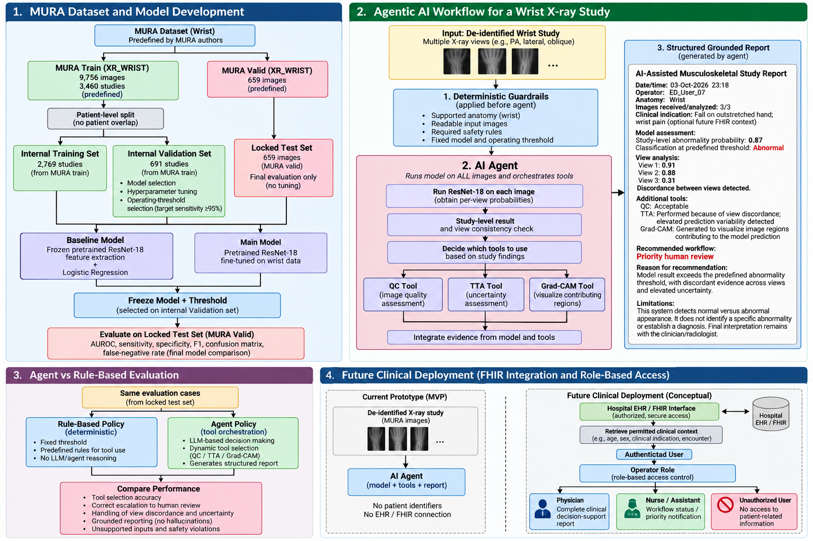
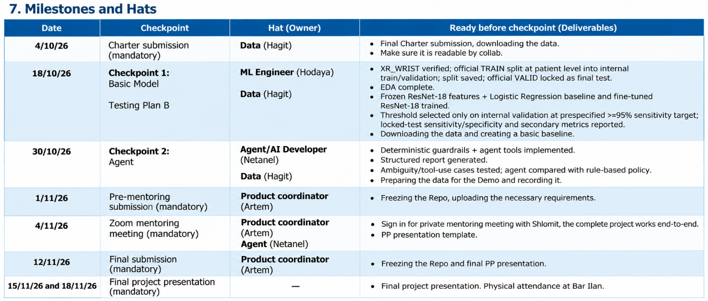

# Agentic AI-Assisted Detection of Musculoskeletal Abnormalities in X-rays

**CAPSTONE PROJECT CHARTER | DS23 DATA SCIENTIST + AGENTIC AI | November 2026**

**Final project DS23 submitted by:** Netanel Farhi, Hodaya Zinowits, Artem Lenchinski and Hagit Niv-Drori

## 1. Problem and User

**Primary user:** Emergency Department physician interpreting musculoskeletal radiographs before expert radiology review is available.

**Need:** Decision support to reduce missed abnormalities that may contribute to delayed diagnosis, inappropriate management, and avoidable return visits. The literature supports evidence of 3-5 % missed abnormalities and 1% 24-hour ED revisits following an initially negative musculoskeletal X-ray assessment.

## 2. Success Metric

**Primary operating strategy:** Prespecify a sensitivity target of >=95%. Select the probability threshold only on the internal validation set, then freeze it.

**Locked-test evaluation:** Report achieved sensitivity and the corresponding specificity on the untouched official MURA wrist validation set, used as the final test set.

**Secondary metrics:** AUROC, F1, confusion matrix and false-negative rate. The 24-hour ED revisit rate is clinical rationale only; it is not applicable on MURA dataset.

## 3. Data and Plan B

### 3.1 Plan A

We will use MURA (musculoskeletal radiographs) which is a large dataset of bone X-rays. MURA is one of the largest public radiographic classified image dataset maintained by Stanford ML group. The dataset is available for algorithms which task the determining whether an X-ray study is normal or abnormal. MVP = XR_WRIST. Study-level NORMAL vs ABNORMAL classification; multiple views may belong to one study.

**Dataset split:** MURA dataset offers predefined train and valid partitions. For this project, the predefined MURA valid partition will be preserved as a locked test set and used only for final evaluation. The predefined train partition will be further divided into internal training, and internal validation both are at the patient level, ensuring that no patient appears in both subsets. The internal validation set will be used for model selection and operating-threshold selection. The locked MURA valid set will not be used for model tuning or threshold selection.

### 3.2 Scale/access

Wrist training population verified in the downloaded dataset: 9,756 images, 3,460 studies and 3,267 patients. Study distribution: 2,134 normal (61.7%) and 1,326 abnormal (38.3%). Official wrist validation contains 659 images and is reserved as the locked final test set. The data was downloaded as a ZIP file after signing in to Stanford AIMI. The ZIP file was loaded to the drive and doesn't require keys to use it. The file is accessed in notebook 01.

### 3.3 Scientific boundary

MURA labels abnormality, not a specific diagnosis. The project will therefore not claim fracture diagnosis or validated fracture localization. All splitting and evaluation are patient/study aware.

### 3.4 Plan B

FracAtlas. If MURA access, preprocessing, or compute prevents completion, fine-tune a pretrained ResNet-18 using transfer learning on FracAtlas. The agentic workflow remains the same, while the clinical task narrows from general abnormality detection to fracture detection. FracAtlas is CC BY 4.0 and includes localization annotations.

## 4. System Architecture

## 5. Agent Role: Orchestration • Reporting • Safety

### 5.1 Decision

The classifier predicts normal vs abnormal. Deterministic guardrails control supported input and the frozen threshold. The agent handles genuine ambiguity, reconciles evidence across views, decides when additional uncertainty assessment is warranted, orchestrates tools, and produces the structured report and allowed workflow recommendation.

### 5.2 Agent-accessible tools

Fine-tuned ResNet-18 abnormality classifier. Technical image QC tool — performs deterministic checks for file readability, supported format, image dimensions, blank/near-uniform images, gross brightness/contrast abnormalities, and study completeness. It does not assess clinical radiographic adequacy or positioning. QC flags are provided to the agent as structured evidence.

Test-time augmentation (TTA) performs additional predictions under predefined test-time transformations to assess prediction stability/uncertainty. Grad-CAM generates activation maps showing image regions contributing to the model's prediction. Agent LLM orchestrates tools when needed, integrates their outputs, handles ambiguous/discordant evidence, and generates the structured grounded report.

### 5.3 Failure

Unsupported, incomplete, invalid, inconsistent or insufficiently reliable input/output → no forced diagnosis. Escalate to human review. The agent may not override deterministic guardrails or invent diagnoses. Final interpretation and clinical decisions remain with the clinician/radiologist.

## 6. Risks, Mitigation & Cut Line

**6.1 Data/compute/preprocessing difficulty:** Use wrist-only MVP and transfer learning. If the MURA path becomes impractical, activate FracAtlas Plan B.

**6.2 Incorrect or overconfident AI output:** Fixed operating threshold, input validation, uncertainty handling, false-negative analysis, grounded reporting and explicit human-review fallback.

**6.3 Asking the agent to do too many things:** run the model, assess disagreement, QC, decide on TTA, Grad-CAM, integrate evidence, recommend workflow, write a report.

**6.4 Cut Line:** If we only have 2 weeks to the deadline, we will minimize agentic MVP meaning ResNet-18 outputs from all views + discordance recognition + optional TTA + grounded structured report + human escalation.

## 7. Milestones and Hats

## 8. Selected References & Data Sources

1. Rajpurkar P, Irvin J, et al. *MURA: Large Dataset for Abnormality Detection in Musculoskeletal Radiographs.* Stanford Machine Learning Group / Stanford AIMI.
2. Brady AP. *Error and discrepancy in radiology: inevitable or avoidable?* Insights into Imaging. 2017;8:171–182.
3. Mattijssen-Horstink L, et al. *Radiologic discrepancies in diagnosis of fractures in a Dutch teaching emergency department: a retrospective analysis.* Scand J Trauma Resusc Emerg Med. 2020;28:38.
4. Graif N, et al. *AI-assisted radiographic fracture detection and length of stay in the adult emergency department.* International Journal of Medical Informatics. 2026;221:106679.
5. Abedeen I, et al. *FracAtlas: A Dataset for Fracture Classification, Localization and Segmentation of Musculoskeletal Radiographs.* Figshare; CC BY 4.0.
