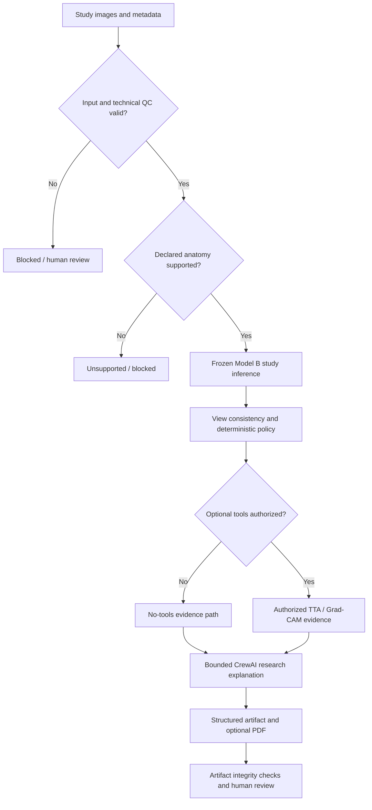

# MURA XR_WRIST — Notebook 09 Agentic AI Architecture and Deterministic Gates

**Source of truth:** `09_MURA_Agentic_AI(4).ipynb` (421 cells, supplied 12 November 2026).  
**Supporting configuration:** `mura_agent_specification.json` (v1.2), `frozen_primary_operating_policy.json`.  
**Scope:** Research-only workflow, separate from the local Wrist Review application's `src/runtime/bounded_agent.py`.

> **Traceability convention:** Cell numbers below are **1-based positions including Markdown cells** in the supplied notebook snapshot. STEP labels are more stable than cell positions. A *runtime gate* prevents downstream work in a particular code path; a *test/assertion* proves a property only when that test cell runs; a *configuration requirement* is not automatically enforced simply because it is declared in JSON.

## Frozen, non-negotiable operating policy

- Classifier: canonical fine-tuned ResNet-18 (**Model B**); study aggregation: `mean_probability`.
- Threshold: **`0.263567715883255`**, selected on **internal validation** with a sensitivity target of 0.95. The policy file records observed sensitivity `0.9516728624535316` and specificity `0.5829383886255924` on that internal-validation cohort.
- The agent may explain verified evidence but must **not** alter weights, model predictions, study probability, aggregation, threshold, or deterministic workflow action.
- Technical QC and supported wrist-anatomy checks precede guarded classification. Human review remains mandatory. No specific diagnosis or validated lesion localization is claimed.
- Optional TTA and Grad-CAM are explanatory evidence, not independent clinical confidence or diagnostic truth.

## Architecture (logical ordering, not a claim that every notebook cell executes sequentially)

The diagram describes the intended evidence flow. The notebook also contains **multiple historical experiments and test harnesses**; do not infer that all cells belong to one production execution path.

## Deterministic-gate traceability matrix

| Stage | Notebook STEP / cell | Required condition or checked invariant | If it fails | Enforcement classification |
|---|---|---|---|---|
| Canonical artifacts | **STEP 2 / cell 6** | All five required Model B files exist; saved threshold matches `SELECTED_THRESHOLD` within `1e-12`; aggregation is `mean_probability`; source is `internal_validation` | `assert` raises; setup does not complete | **Setup assertions** |
| Agent specification | **STEP 4 / cell 9** | Checkpoint and policy exist; frozen threshold and aggregation match; checkpoint metadata contains epoch **9** | `assert` raises | **Setup assertions**; JSON requirements alone are declarative |
| Image QC | **STEP 5 / cell 11**; tests **5A–5B / cells 12–13** | Nonempty encoded bytes, decodable grayscale image, engineering checks for size/brightness/contrast | QC returns structured `FAIL` and blocking status for invalid input | **Function behavior**, with separate tests; heuristic thresholds are not clinical validation |
| Study classification input | **STEP 9 / cell 23**; tests **9A–9D / cells 24–27** | Valid study ID, nonempty image list, valid per-image records, QC before Model B inference | Structured `BLOCKED` result on rejected input | **Runtime validation inside `classify_study`** |
| Anatomy scope | **STEP 11 / cell 32**; **11B / cell 34** | Supplied metadata identifies supported wrist anatomy; not image-based anatomical recognition | Unsupported/blocked outcome rather than forced classification | **Guarded wrapper**; test in **11A / cell 33** |
| Combined guarded classification | **STEP 12 / cell 36** | Anatomy gate and technical checks succeed before model result is accepted | Classification is blocked or safely routed | **Runtime wrapper**; blocking tests **12A / cell 37**, **13 / cells 40–42** |
| View evidence | **STEP 14 / cell 45**; **15 / cell 48** | Study/view probabilities can be compared to frozen threshold; disagreement computed deterministically | Missing/invalid evidence must not be treated as verified agreement | **Deterministic computation and unit tests**; inspect callers for gating |
| TTA tool | **STEP 19 / cell 50**; **20 / cell 52**; **22–23 / cells 56, 58** | Only valid, authorized input; perturbation outputs must be numerically usable | Tool error or unavailable evidence; cannot change frozen classification | **Optional tool and validation tests**, not mandatory for every study |
| Grad-CAM tool | **STEP 25 / cell 63**; **26 / cell 65**; **27–28 / cells 67, 69** | Compatible frozen model, image and layer; returned attribution must be usable | No validated overlay/evidence; do not infer localization | **Optional tool and validation tests** |
| Deterministic action selection | **STEP 30 / cell 74** | Policy maps verified model/QC/view evidence to allowed workflow actions and tool eligibility | Safe action/block/escalation according to implemented branch | **Decision function**; confirm specific branch in each run |
| Agent orchestration | **STEP 33 / cell 83**; integration **34 / cell 86**, **35 / later cells** | Guarded result and policy are available before explanation/tool orchestration | Safe failure or explicit error, not an agent override | **Integration path and tests**; no blanket guarantee for historical variants |
| Research artifact schema | **STEP 73 / cell 379**; **74 / cell 381** | Typed artifact fields and research/human-review constraints validate | Schema validation rejects invalid artifact | **Pydantic schema and validation** |
| Persisted artifact integrity | **STEP 80B / cell 395**; **82 / cell 401** | Study alias, schema, research-only and human-review flags, unchanged classification/policy, saved-file existence | `assert`/schema failure | **Read-only post-run validation**, not pre-inference gate |
| No-tools integrity | **STEP 82C / cell 402** | Compare source/saved probability, class, threshold, policy and tool statuses | Differences are printed; not all comparisons are asserted | **Diagnostic comparison**; do **not** label every printed check a blocking gate |
| LLM monitoring | **STEP 89H / cell 414**; **89K / cell 417** | Offline simulated call tracking and cross-run isolation | Assertions fail in test | **Offline tests only**, not proof of live event interception |
| LLM call budget | **STEP 89O / cell 421**; **STEP 63A / cells 188–189**; **STEP 63B / cell 190** | Three reservations permitted, fourth denied; a temporary CrewAI before-call hook also blocks the fourth mocked LLM call | `LLMCallBlockedError`; structured stop reason `LLM_CALL_BUDGET_EXCEEDED` | **Passed offline unit and mocked CrewAI-hook tests**; not proof of live Gemini enforcement |

## Verified execution limits and explicit stop reasons

The notebook includes **positive test evidence that the budget mechanism responds to its limit**, not merely a declared configuration:

- **STEP 89O / cell 421:** A run-scoped budget permits three reservations and denies the fourth. Saved output: `Fourth reservation: BLOCKED`; offline test `PASSED`.
- **STEP 63A / cells 188–189:** Reuses the budget and structured execution reporter. The saved test output confirms independent run budgets, a blocked fourth reservation, `INCOMPLETE`, `LLM_CALL_BUDGET_EXCEEDED`, and mandatory human review. Its verification record explicitly marks `crewai_runtime_enforcement_verified: False`.
- **STEP 63B / cell 190:** Registers a temporary CrewAI before-LLM-call hook and mocks the completion method. Three calls return mocked responses; the fourth raises `LLMCallBlockedError`. The hook is removed after testing. **No Gemini API calls and no agent execution** occurred in this test.
- **Iteration limit:** The notebook configures and asserts `max_iter=3` in the CrewAI agent tests (including **STEP 64L–64M / cells 205–206**, **STEP 65G / cell 216**, and **STEP 65Q–65W / cells 226–232**). The execution reporter explicitly supports `AGENT_ITERATION_LIMIT_REACHED`. The configured bound and response/reporting path are documented; do not imply that every actual Gemini attempt was independently counted or that all executions emitted this stop reason.

### Structured execution outcomes and system stop messages

The reporter in **STEP 63A / cell 188** (`build_execution_report_91a`) defines these outcomes, in precedence order:

| Condition | Execution status | Stop reason / system code | Consequence |
|---|---|---|---|
| LLM call budget exceeded | `INCOMPLETE` | `LLM_CALL_BUDGET_EXCEEDED` | No completed report is claimed; human review required |
| Agent iteration limit confirmed | `INCOMPLETE` | `AGENT_ITERATION_LIMIT_REACHED` | No completed report is claimed; human review required |
| Agent execution error | `INCOMPLETE` | `AGENT_EXECUTION_ERROR` | No completed report is claimed; human review required |
| Completion not confirmed | `INCOMPLETE` | `COMPLETION_NOT_CONFIRMED` | No completed report is claimed; human review required |
| Execution confirmed completed | `COMPLETED` | `None` | Research result may proceed to artifact validation; human review still required |

These are **reporter codes**. Their presence in the reporter is not by itself evidence that every failure in every historical execution path automatically invokes the reporter.

### Deterministic conditions that prevent normal classification or routing

The following conditions are explicitly checked by the **STEP 9 / cell 23** classifier, **STEP 11 / cell 32** anatomy validator, **STEP 12 / cell 36** guarded wrapper, and **STEP 30 / cell 74** decision policy:

| Condition | Implemented behavior | Where to inspect |
|---|---|---|
| Invalid or missing study ID; missing/empty study images; malformed image record; duplicate image IDs | Classification returns `BLOCKED` with an issue code | STEP 9 / cell 23 |
| Technical QC `FAIL`, including a failed image | Classification returns `BLOCKED` with `qc_failed: ...` | STEP 5 / cell 11; STEP 9 / cell 23 |
| Technical QC `WARNING` or missing QC in deterministic policy | `human_escalation` (not `routine_workflow`) | STEP 30 / cell 74 |
| Unsupported or uncertain anatomy; missing/untrusted image paths, images absent from trusted index, or mixed studies | Anatomy gate does not establish `SUPPORTED_WRIST`; policy returns `unsupported_input` for explicitly unsupported/uncertain scope or `human_escalation` for other invalid scope states | STEP 11 / cell 32; STEP 12 / cell 36; STEP 30 / cell 74 |
| Inference exception, mismatched prediction count, or non-finite model outputs | Classification returns `ERROR`; downstream success must not be assumed | STEP 9 / cell 23 |
| Missing or failed classification status | `human_escalation` | STEP 30 / cell 74 |
| Noncanonical or invalid threshold; missing/out-of-range/non-finite probability; invalid class; missing/invalid view probabilities | `human_escalation` | STEP 30 / cell 74 |
| Mean aggregation mismatch or class/threshold inconsistency | `human_escalation`, without modifying the frozen classification | STEP 30 / cell 74 |

**QC-report coverage limitation:** We tested QC failure/blocking and deterministic routing, **but did not test or verify the final PDF layout/content for a QC-failed study**. Do not claim that a QC-failure PDF was generated or visually validated. The structured stop codes above belong to the execution reporter; they are not automatically the same as the classifier's `issues` strings or the policy's `action` values.

## CrewAI TASK — explicit execution contract

**The TASK is the agent's bounded assignment, not a new clinical decision-maker.** Its role is to prepare a grounded research explanation using the already frozen Model B result, deterministic policy decision, and only the evidence/tools authorized for the particular study. The TASK must not change the model probability, class, threshold, aggregation or routing action; the output remains research-only and subject to human review.

| Evidence in Notebook 09 | Cell | Meaning |
|---|---:|---|
| **STEP 64L** — Agent and TASK initialization | **205** | Constructs the CrewAI `Agent` and `Task` for a study alias, after prerequisite assertions; saved output identifies the assigned tools and task. **No kickoff** in this cell. |
| **STEP 64M** — final TASK/Agent verification | **206** | Checks task initialization, authorized tools, privacy-safe alias, unchanged frozen result and mandatory review. |
| **STEP 65Q–65W** — execution safety and fresh-Crew factory | **226–232** | Tests bounded configuration and a factory for independent execution objects. These are not proof that every later execution automatically creates new objects. |
| **STEP 68D–68I** — task binding and execution experiments | **276–281** | Integrates TASK and execution context; saved results include both failure handling and a completed research explanation in different experiments. |

**Required TASK gate:** do not start an explanation until the guarded classification and deterministic policy are available, the study identity is fixed, and the tool allowlist is derived from that study's policy. If execution is incomplete, record the stop reason rather than presenting a completed TASK. These are the documented requirements; each live execution path must be checked for enforcement.

## Memory, stale-state prevention, logging, and recovery loops

The notebook investigated several related but distinct problems. **CrewAI long-term memory is disabled** in the inspected configuration; short-term execution state, audit logs, and event listeners are separate mechanisms. Here, *stale state* means leftover run-specific data, hooks, task/agent objects, or counters contaminating a later study—not a claim that a CrewAI stale-memory API was verified.

| Loop / control | Notebook STEP and cell | Test evidence and expected behavior |
|---|---|---|
| **Run identity and fresh execution objects** | **65U–65W / 230–232** | Inspected executor/iteration state and verified a fresh Crew factory with independent execution objects. This supports the proposed study-by-study reset design. |
| **Short-term state and in-memory audit loop** | **66J–66L / 246–248** | Verified `memory=False`, `cache=False` in the inspected Crew configuration, independent state copies, state transitions, and run isolation; audit events were verified in memory. |
| **Local log serialization** | **66M / 249** | Wrote and read a temporary JSONL log; **this cell alone did not persist to Drive**. |
| **Google Drive log persistence and read-back** | **66N–66O / 250–251** | Saved audit events to Google Drive and verified file existence/content by reading them back; output explicitly reports `PASSED` and `Persistence: VERIFIED`. |
| **Logging failure and pending-event recovery** | **66R, 66U–66X / 254, 257–260** | Simulated failed writes, preserved prior logs, tested temporary-file cleanup, pending events, retry/recovery, and read-back integrity. These are controlled failure tests; they do not imply that every live provider failure was exercised. |
| **Execution failure diagnostics** | **67D–67H / 267–271** | Identified missing diagnostic fields, then verified validation of failure records, persistence/read-back, and preservation of failed state. |
| **Study artifact persistence** | **81 and 82A / 397, 399** | Verified saved JSON research artifacts and Google Drive storage for `RANDOM_001`, `RANDOM_002`, and `NO_TOOLS_001`. STEP 82A reported three artifacts verified, zero files written in that read-only verification, and no new inference or Gemini calls. |
| **LLM event monitoring and cross-run isolation** | **89H–89N / 414–420** | Tested simulated started/completed/failed calls, registered and removed temporary listeners, and verified separation of `RUN_A` and `RUN_B`. **89K / 417** reported `Cross-run isolation: PASSED`; these were offline tests, not live event-stream validation. |
| **Run-scoped LLM budget** | **89O / 421** | Verified independent budget accounting and denial of a fourth reservation after three allowed reservations. |

### Intended per-study lifecycle (planned hardening)

For **each new study**, the planned workflow is:

1. Allocate a new `study_id`/`run_id`, independent execution state, audit record, and budget counters.
2. Re-validate study input, QC, anatomy, frozen Model B result and deterministic policy **for that study**.
3. Build **fresh Agent, TASK, Crew, and study-specific tool wrappers/allowlist**; do not reuse previous study evidence or mutable tool state.
4. Register only the listeners/hooks needed for the current run; prevent duplicate registrations and avoid carrying over stale callbacks.
5. Execute only authorized actions, track iterations/call budgets and record structured success/failure events.
6. Persist JSONL audit logs and research artifacts; verify existence and read-back integrity where supported.
7. Clean up temporary hooks/listeners, pending execution objects and run-scoped counters before processing another study.

**Status:** This is an **explicit planned reorganization** of agent tools on every run to prevent `STUDY_A`/`STUDY_B` cross-contamination. The notebook contains component and offline isolation tests, but they must not be described as proof that all seven lifecycle steps are already enforced in every live execution.

## End-to-end notebook execution

**Notebook 09 was run end-to-end during project development**, as reported in the project workflow. The supplied notebook also preserves successful test outputs, completed CrewAI research executions, artifact checks, and Google Drive persistence verification. This statement concerns the completed development run; it **does not** mean that every historical experimental cell is part of a single production execution path, that every failure scenario was run live, or that the QC-failure PDF layout was tested.

## Key safety distinctions

### What is deterministic

The frozen threshold, mean study aggregation, QC/anatomy eligibility, allowed workflow actions, tool authorization, and schema assertions are governed by code and configuration rather than by free-form LLM interpretation **where those functions are invoked**. The policy file and agent specification must be checked against the runtime implementation; merely listing a rule in JSON does not enforce it.

### What is generated by the LLM

CrewAI produces a research explanation from provided evidence. It does not constitute a new classifier, independent diagnosis, or source of authority over deterministic policy. The notebook contains multiple CrewAI configurations from development; describe a particular execution only with its corresponding STEP and saved audit evidence.

### What the notebook does **not** establish

- That every notebook cell is a required sequential production stage.
- That all assertions in test cells are executed on every new study.
- That the offline budget and mocked CrewAI-hook tests prove enforcement across every live Gemini request or internal SDK retry.
- That an estimated token cost is a provider billing record.
- That successful internal tests constitute external clinical validation.

## Report and artifact paths

- `reports/agentic_ai/research_artifacts/`: structured research JSON for `RANDOM_001`, `RANDOM_002`, and `NO_TOOLS_001`.
- `reports/agentic_ai/research_reports/`: PDF research reports for the same three aliases, if uploaded.
- `NO_TOOLS_001` records `tta_uncertainty` and `gradcam_explainer` as `NOT_EXECUTED`; it must not be represented as containing newly generated Grad-CAM evidence.

## Reproducibility and governance

1. Preserve the frozen Model B checkpoint and threshold, and verify the canonical files before inference.
2. Record the notebook version and STEP/cell identifiers for every reported test.
3. Keep original radiographs, private paths, credentials, and model weights outside the public repository.
4. Use de-identified study aliases and verify saved reports for sensitive content.
5. Keep the local Wrist Review bounded-agent design/status documents unchanged; this document describes the **separate Notebook 09 research workflow**.

## Evidence still worth verifying before treating this as a formal safety specification

The matrix is a **code-location audit** of the supplied notebook, not a formal proof of complete end-to-end enforcement. For each actual execution route, confirm that its callers invoke the QC/anatomy/policy guards, that tool authorization is checked before tool execution, and that execution errors preserve the safe outcome. In particular, link any live LLM-call budget enforcement to its actual CrewAI invocation path rather than treating the passed STEP 89O and mocked STEP 63B tests as proof of every live Gemini request. The QC-failure PDF presentation also remains untested.
