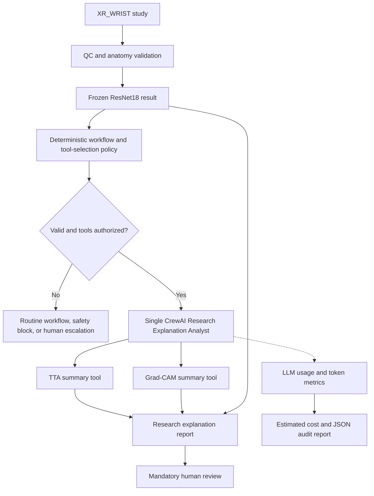

# MURA Agentic AI — Agent Architecture and Execution Summary

## Purpose

This project combines a **frozen ResNet18 classifier** for MURA XR_WRIST radiographs with a **deterministic safety and tool-selection policy** and a **CrewAI research explanation agent**. The agent summarizes verified evidence; it is not permitted to modify the model's prediction, probability, threshold, or workflow decision. Outputs are for research use only and require human review.

## How many agents?

**The latest live workflow (Steps 93–94) uses one CrewAI agent**, named **MURA Research Explanation Analyst** (`agent_93`). Its Crew (`crew_94`) contains `agents=[agent_93]` and one task (`task_93`). It does not delegate to other agents (`allow_delegation=False`).

The notebook contains **other agent objects from earlier development and testing**, including a policy-authorized coordinator, a policy-gated coordinator, and a policy-gated research analyst. They are separate experimental configurations, **not multiple cooperating agents in the Step 94 run**.

| Component | Type | Responsibility |
|---|---|---|
| Frozen ResNet18 | ML classifier | Produces study-level classification and probability |
| Technical QC and anatomical checks | Deterministic validation | Rejects unsupported or invalid inputs |
| `agent_policy.py` (v1.1) | Deterministic policy module | Validates study results, selects allowed explanation tools and workflow action |
| `MURA Research Explanation Analyst` | **One CrewAI agent** | Calls authorized tools and writes a grounded research explanation |
| `mura_tta_summary` | CrewAI tool | Returns verified test-time augmentation sensitivity evidence |
| `mura_gradcam_summary` | CrewAI tool | Returns verified spatial-attribution metadata |
| Human reviewer | Human oversight | Reviews findings; the agent does not provide a clinical diagnosis |

## Architecture

The diagram shows the **policy-authorized explanation path**; it does not imply that every study runs both tools. The policy determines eligibility. The tools in the latest live test returned previously computed and validated research evidence rather than retraining or rerunning ResNet18.

## Agent configuration in the latest live test

- **Role:** `MURA Research Explanation Analyst`
- **LLM:** `gemini-3.1-flash-lite` through CrewAI
- **Goal:** Explain frozen MURA findings using authorized tools
- **Delegation:** disabled (`allow_delegation=False`)
- **Iteration limit:** `max_iter=4`
- **Task retry limit in Step 93E:** `max_retry_limit=0`
- **Crew:** sequential process, one agent, one task, memory and cache disabled
- **Authorized tools for tested study:** `mura_tta_summary`, `mura_gradcam_summary`

## Live execution evidence — Step 94A

| Metric | Recorded value |
|---|---:|
| Study | `OFFICIAL_STUDY_00137` |
| Frozen predicted class | 1 (positive) |
| Frozen study probability | 0.09145868569612503 |
| Frozen classification threshold | 0.0600893441587686 |
| Execution status | COMPLETED |
| Duration | 23.76 seconds |
| Successful LLM requests reported by CrewAI | 4 |
| Prompt tokens | 2,764 |
| Completion tokens | 1,220 |
| Total tokens | 3,984 |
| Cached prompt tokens | 0 |
| TTA tool | Executed successfully |
| Grad-CAM tool | Executed successfully |
| Estimated LLM cost in Step 94B | $0.002521 |

**Cost calculation used in the notebook:** 2,764 input tokens at $0.25 per million and 1,220 output tokens at $1.50 per million. This is a **notebook estimate based on its configured prices and CrewAI usage metrics**, not proof of actual provider billing. The notebook also reports that CrewAI uses approximate input-token counting for this model. `successful_requests=4` is not a guaranteed count of every HTTP attempt, including failed retries.

### Interpretation of the tools

- **TTA:** The recorded mean probability was approximately 0.08988; no threshold disagreement was reported for the tested image transformations. This measures sensitivity to those transformations, **not diagnostic correctness or calibrated uncertainty**.
- **Grad-CAM:** The tool returned attribution metadata for `OFFICIAL_IMAGE_000387` using `layer4[-1].conv2`, with a 320 × 320 heatmap shape. It **does not establish fracture localization or clinical diagnosis**.
- **Human review:** Mandatory. The agent must not infer ground-truth labels from its evidence or override the frozen prediction.

## Scope and limitations

1. The latest live demonstration uses **one study** and **one agent**; it is not a multi-agent CrewAI system.
2. Earlier notebook cells instantiate other agents for experiments and safety tests; these should not be represented as simultaneous participants in Step 94.
3. The deterministic policy, not the LLM, is the authority for safety checks and tool permissions.
4. Token costs are estimates, and the current `max_iter` setting is **not** a hard dollar-cost cap.
5. A broader evaluation should compare study types and validate report fidelity, tool gating, and budget behavior.

## Notebook traceability

- **Step 53:** Reusable deterministic policy module (`agent_policy.py`, version 1.1).
- **Steps 83M and 83R:** Earlier policy-aware / policy-gated CrewAI configurations.
- **Step 85G–85H:** Verified research-evidence restoration and authorized-tool checks.
- **Step 93:** One-agent live false-positive research explanation.
- **Steps 93C–93F:** Gemini credential refresh, Crew preparation, and successful live execution.
- **Step 94A:** Live execution and usage metrics.
- **Step 94B:** JSON execution and estimated-cost report.

## Reproducibility and security

Keep API keys in Colab Secrets or environment variables, never in notebook source or saved outputs. Notebook outputs may be retained for teaching and audit purposes after checking for sensitive content. The JSON audit report created by Step 94B is saved in the Colab runtime and should be added to the repository separately if desired.
