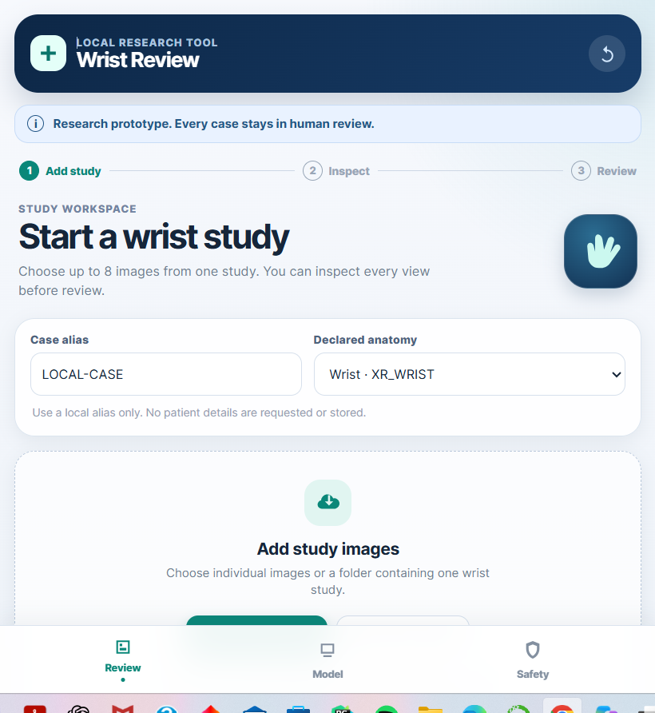

# Wrist Review app — local research prototype

## Actual interface capture

> This is a local browser capture of the running application before a study is
> selected. It contains no MURA radiograph, patient data, local data path, or
> model output from a real case. The browser frame and taskbar are not part of
> the product UI.

## Conceptual product flow

> This three-phone image is conceptual product-flow artwork, **not a screenshot
> of the running application**. The actual local interface is implemented in
> [`apps/wrist_review`](../../apps/wrist_review/).

## Purpose

Wrist Review is a **local-only research interface** for the verified
Checkpoint 1 Model B workflow. It makes the worklist process visible to a
reviewer: choose a local folder containing one or more wrist studies, inspect
the selected file, apply deterministic input checks, and receive a safe
priority ordering for human review.

It does not diagnose fracture, localize an abnormality, prescribe treatment,
or clear a case from standard human review.

## User flow

1. **Add worklist** — select a local patient folder, append further patient
   folders, or select one ZIP containing several patient/study folder trees. The
   ZIP is read in memory only and is limited to 100 MB compressed, 50 MB
   expanded, 400 files, and 15 MB per image. A study with more than eight files
   is rejected; the app never silently discards views.
2. **Inspect views** — choose a study and any selected file from its study list; view its
   local preview, file details, image dimensions, and technical-QC status.
3. **Review worklist** — only real selected views are passed study-by-study to the verified
   Model B runtime. The app mean-pools the view probabilities at study level
   and applies the frozen internal-validation threshold.
4. **Receive a safe route and order** — `RAISE_PRIORITY`,
   `STANDARD_HUMAN_REVIEW`, `NEEDS_HUMAN_REVIEW`, or `UNSUPPORTED`; every
   case remains in the human-review queue.

Do not enter patient identifiers in the alias, folder name, or file name.
Those values can be visible in the local interface even though the server does
not persist uploads, image bytes, or request logs.

## Deterministic route summary

| Condition | Result | Model inference |
| --- | --- | --- |
| Empty/duplicate input or more than 8 views | Selection/API request rejected | No |
| Unsupported declared anatomy | `UNSUPPORTED` | No |
| Missing/unknown declared anatomy or failed QC | `NEEDS_HUMAN_REVIEW` | No |
| Missing/invalid canonical bundle, policy, or checkpoint hash | Fail closed — no review result | No |
| Verified study mean reaches the frozen threshold, or view scores disagree across it | `RAISE_PRIORITY` | Yes |
| Verified study mean remains below threshold and views do not disagree across it | `STANDARD_HUMAN_REVIEW` | Yes |

If the canonical model bundle, frozen policy, or expected checkpoint hash is
missing or invalid, the app fails closed: it returns no model review result.
The local Model screen shows the artifact issue and the bundle must be fixed
before a review can proceed.

## Safety policy built into the interface

- It accepts only **declared** `XR_WRIST` studies; unsupported declared anatomy
  does not reach the classifier. This is not automatic body-part recognition:
  the current selector is a user-provided routing input. An automatic
  body-part/support checker is planned before any broader workflow claim.
- Technical QC runs before model inference. Corrupt, tiny, or near-uniform
  inputs are routed to `NEEDS_HUMAN_REVIEW`.
- The frozen Model B checkpoint and threshold are checksum/policy verified
  before inference.
- A result can raise review priority but **never removes mandatory human
  review**.
- The app keeps uploads in process memory for the local request only; it does
  not persist image bytes, file paths, or patient identifiers.

## Relationship to the Agentic-AI workflow

The app first runs the deterministic baseline. Optional local evidence is authorized
only by the explicit policy file: the mean study prediction is abnormal, valid wrist
views disagree across the frozen threshold, or the mean is inside the configured
borderline band around that threshold. When authorized, the local layer runs one TTA
stability check and one in-memory Grad-CAM summary. It has no external access and
cannot choose unapproved tools, change the score, threshold, or route.

The app also contains an **optional, opt-in CrewAI bridge** aligned with the
Notebook 09 research contract. For every valid supported study, it creates a fresh
single-agent CrewAI run with `max_iter=3` and at most three LLM-call reservations.
The agent receives no optional tool for a consistent normal study. For an authorized
study, it can retrieve precomputed TTA and Grad-CAM **summaries** only; Grad-CAM maps
remain local and are not persisted. It receives a generated study alias plus structured
QC/model/evidence values — never raw pixels, file names, local paths, labels, or patient
identifiers. Its JSON response is
schema-validated before display; any configuration, provider, budget, or schema
failure retains the deterministic route and mandatory human review.

CrewAI is disabled by default, so the normal local app makes no external provider
call. The bridge is a research explanation layer, not an adaptive classifier or a
clinical decision-maker. It still requires the planned comparison against
deterministic routing and a fixed-tool workflow on an independent case suite. See
[AGENT_DESIGN.md](../../agents/AGENT_DESIGN.md),
[AGENT_IMPLEMENTATION_STATUS.md](../../agents/AGENT_IMPLEMENTATION_STATUS.md),
and [AGENT_EVAL_PLAN.md](../../evaluation/AGENT_EVAL_PLAN.md).

## Local run requirements

The app code is in [`apps/wrist_review`](../../apps/wrist_review/). It is
deliberately usable only with authorized local artifacts:

- the repository checkout;
- Python dependencies from `requirements.txt`;
- a local, checksum-verified canonical Model B bundle; and
- de-identified, authorized local research images.

Neither the model bundle nor MURA images are committed to Git. The app checks
that the checkpoint hash and the frozen-policy provenance match the canonical
bundle before it permits model inference.

## Current status

The interface, deterministic runtime, bounded TTA/Grad-CAM investigation, and optional
CrewAI explanation bridge are implemented as a local research prototype. It has
not undergone clinical usability validation, deployment security review, live
provider budget validation, or the planned independent adaptive-agent evaluation.
It must be shown as a workflow prototype rather than evidence of clinical
readiness.
