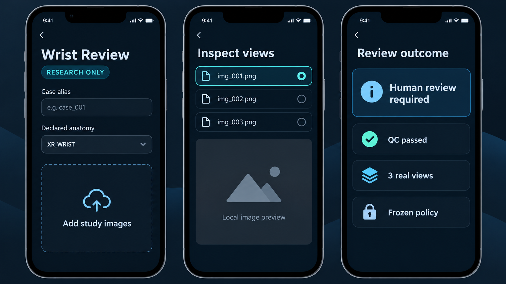

# Wrist Review app — local research prototype

> The visual above is a product-flow illustration only. It contains no MURA
> radiographs, patient data, model output from a real case, or clinical claim.

## Purpose

Wrist Review is a **local-only research interface** for the verified
Checkpoint 1 Model B workflow. It makes the study-level process visible to a
reviewer: choose the views belonging to one wrist study, inspect the selected
file, apply deterministic input checks, and receive a safe workflow outcome.

It does not diagnose fracture, localize an abnormality, prescribe treatment,
or clear a case from standard human review.

## User flow

1. **Add study** — select 1–8 local image files or one local folder, enter a
   non-identifying case alias, and declare the anatomy.
2. **Inspect views** — choose any selected file from the study list; view its
   local preview, file details, image dimensions, and technical-QC status.
3. **Review study** — only real selected views are passed to the verified
   Model B runtime. The app mean-pools the view probabilities at study level
   and applies the frozen internal-validation threshold.
4. **Receive a safe route** — `RAISE_PRIORITY`, `STANDARD_HUMAN_REVIEW`,
   `NEEDS_HUMAN_REVIEW`, or `UNSUPPORTED`.

## Safety policy built into the interface

- It accepts only declared `XR_WRIST` studies; unsupported anatomy does not
  reach the classifier.
- Technical QC runs before model inference. Corrupt, tiny, or near-uniform
  inputs are routed to `NEEDS_HUMAN_REVIEW`.
- The frozen Model B checkpoint and threshold are checksum/policy verified
  before inference.
- A result can raise review priority but **never removes mandatory human
  review**.
- The app keeps uploads in process memory for the local request only; it does
  not persist image bytes, file paths, or patient identifiers.

## Relationship to the Agentic-AI plan

This is the deterministic baseline required before an adaptive agent is
considered. It does **not** implement the planned adaptive Agentic AI layer.
That later layer must remain bounded by the same safety policy and be evaluated
against deterministic routing and a fixed tool workflow on an independent
case suite. See [AGENT_DESIGN.md](../../agents/AGENT_DESIGN.md) and
[AGENT_EVAL_PLAN.md](../../evaluation/AGENT_EVAL_PLAN.md).

## Local run requirements

The app code is in [`apps/wrist_review`](../../apps/wrist_review/). It is
deliberately usable only with authorized local artifacts:

- the repository checkout;
- Python dependencies from `requirements.txt`;
- a local, checksum-verified canonical Model B bundle; and
- de-identified, authorized local research images.

Neither the model bundle nor MURA images are committed to Git. The app checks
that the checkpoint hash and the frozen-policy provenance match the canonical
bundle before it permits model inference.

## Current status

The interface and deterministic runtime are implemented as a local research
prototype. It has not undergone clinical usability validation, deployment
security review, or the planned independent agent evaluation. It must be shown
as a workflow prototype rather than evidence of clinical readiness.
