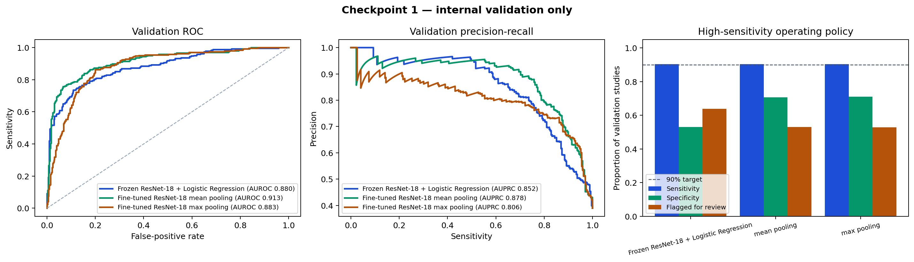
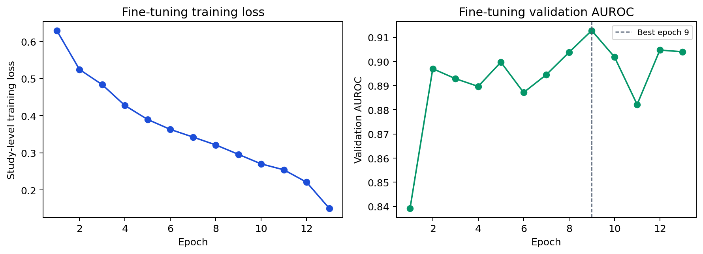

# Archived Checkpoint 1 development results — pre 95 percent protocol

> Historical record only. These results used a sensitivity >=90% development
> policy before lecturer-feedback alignment. The prior Model A regularization
> selection also used internal validation, so it is not the current grouped-CV
> baseline protocol. The files are preserved for traceability and must not be
> presented as the current result.

# Checkpoint 1 — internal validation results (historical)

This page is generated from local, study-level predictions on the **internal
patient-level validation split drawn from official MURA train**. It contains
aggregate metrics only: no radiographs, identifiers, per-study predictions,
checkpoints, or local paths are committed.

## Evaluation cohort

- 691 studies from 653 patients
- 422 NORMAL and 269 ABNORMAL studies
- The official MURA `valid` split was **not read** for this Checkpoint 1 run.

## Model comparison

The threshold in this table is the highest internal-validation threshold that
achieves sensitivity ≥ 90%; it is an operating-policy analysis on the
same development split, not a final clinical claim.

| model                                  |   auroc |   auprc |   threshold_at_target |   sensitivity_at_target |   specificity_at_target |   precision_at_target |   f1_at_target |   false_negative_at_target |   false_positive_at_target |   flagged_percent_at_target |
|:---------------------------------------|--------:|--------:|----------------------:|------------------------:|------------------------:|----------------------:|---------------:|---------------------------:|---------------------------:|----------------------------:|
| Frozen ResNet-18 + Logistic Regression |   0.88  |   0.852 |                 0.128 |                   0.903 |                   0.531 |                 0.551 |          0.685 |                         26 |                        198 |                      63.821 |
| Fine-tuned ResNet-18 mean pooling      |   0.913 |   0.878 |                 0.381 |                   0.903 |                   0.706 |                 0.662 |          0.764 |                         26 |                        124 |                      53.111 |
| Fine-tuned ResNet-18 max pooling       |   0.883 |   0.806 |                 0.863 |                   0.903 |                   0.711 |                 0.666 |          0.767 |                         26 |                        122 |                      52.822 |

## Patient-cluster bootstrap uncertainty

The following 95% intervals resample patients rather than individual views.
Sensitivity and specificity treat the displayed sensitivity-constrained
threshold as fixed within each resample.

| model                                  | AUROC 95% CI   | AUPRC 95% CI   | Sensitivity 95% CI   | Specificity 95% CI   |
|:---------------------------------------|:---------------|:---------------|:---------------------|:---------------------|
| Frozen ResNet-18 + Logistic Regression | 0.854–0.907    | 0.812–0.889    | 0.866–0.936          | 0.485–0.579          |
| Fine-tuned ResNet-18 mean pooling      | 0.889–0.935    | 0.832–0.916    | 0.865–0.937          | 0.663–0.751          |
| Fine-tuned ResNet-18 max pooling       | 0.855–0.907    | 0.750–0.855    | 0.869–0.935          | 0.671–0.754          |

## Fine-tuning training history

## Diagnostic robustness check

The separate [shortcut and geometry diagnostic](shortcut_audit.md) records
aggregate perturbation results only. It is a model-diagnostic warning check,
not a second performance evaluation or localization result.

## Interpretation limits

- These are **development/validation** results, not results from an untouched
  final test set.
- MURA `ABNORMAL` does not mean acute fracture, and no model output is a
  diagnosis or localization claim.
- The high-sensitivity policy intentionally raises the proportion of studies
  flagged for human review.
- Patient-cluster bootstrap intervals quantify sampling uncertainty but do not
  turn this split into a final test set.
