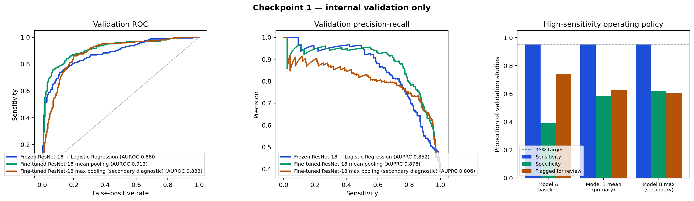
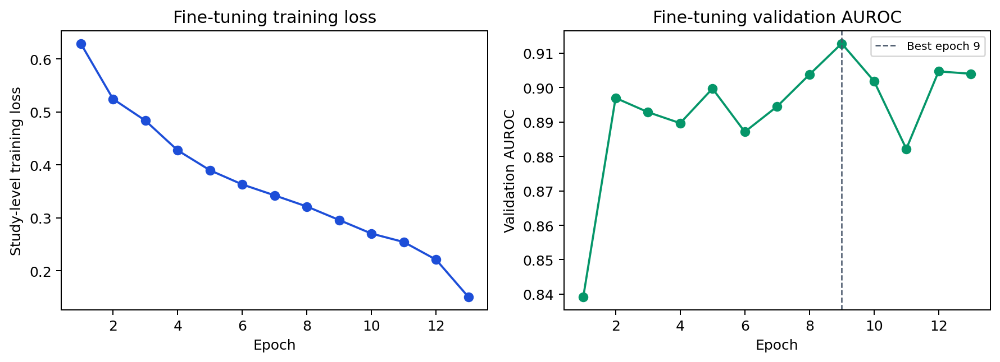

# Checkpoint 1 — internal validation results

This page is generated from local, study-level predictions on the **internal
patient-level validation split drawn from official MURA train**. It contains
aggregate metrics only: no radiographs, identifiers, per-study predictions,
checkpoints, or local paths are committed.

## Evaluation cohort

- 691 studies from 653 patients
- 422 NORMAL and 269 ABNORMAL studies
- The official MURA `valid` split was **not read** for this Checkpoint 1 run.

## Model comparison

The threshold in this table is the highest internal-validation threshold that
achieves sensitivity ≥ 95%; it is an operating-policy analysis on the
same development split, not a final clinical claim.

The primary comparison is the required frozen-embedding Logistic Regression
baseline versus the existing fine-tuned ResNet-18 under the revised protocol's
primary mean study-pooling policy. Max pooling is included only as a
transparent secondary diagnostic. The saved Model B weights were not retrained
for this reporting update.

| model                                                   |   auroc |   auprc |   threshold_at_target |   sensitivity_at_target |   specificity_at_target |   precision_at_target |   f1_at_target |   false_negative_at_target |   false_positive_at_target |   flagged_percent_at_target |
|:--------------------------------------------------------|--------:|--------:|----------------------:|------------------------:|------------------------:|----------------------:|---------------:|---------------------------:|---------------------------:|----------------------------:|
| Frozen ResNet-18 + Logistic Regression                  |   0.88  |   0.852 |                 0.064 |                   0.952 |                   0.393 |                 0.5   |          0.656 |                         13 |                        256 |                      74.096 |
| Fine-tuned ResNet-18 mean pooling                       |   0.913 |   0.878 |                 0.264 |                   0.952 |                   0.583 |                 0.593 |          0.73  |                         13 |                        176 |                      62.518 |
| Fine-tuned ResNet-18 max pooling (secondary diagnostic) |   0.883 |   0.806 |                 0.615 |                   0.952 |                   0.621 |                 0.615 |          0.747 |                         13 |                        160 |                      60.203 |

## Patient-cluster bootstrap uncertainty

The following 95% intervals resample patients rather than individual views.
Sensitivity and specificity treat the displayed sensitivity-constrained
threshold as fixed within each resample. These fixed-threshold intervals understate uncertainty because the threshold itself was selected on the same cohort; do not use them to claim a difference between models. Use the paired table below.

| model                                                   | AUROC 95% CI   | AUPRC 95% CI   | Sensitivity 95% CI   | Specificity 95% CI   |
|:--------------------------------------------------------|:---------------|:---------------|:---------------------|:---------------------|
| Frozen ResNet-18 + Logistic Regression                  | 0.854–0.907    | 0.812–0.889    | 0.927–0.974          | 0.349–0.441          |
| Fine-tuned ResNet-18 mean pooling                       | 0.889–0.935    | 0.832–0.916    | 0.924–0.976          | 0.536–0.628          |
| Fine-tuned ResNet-18 max pooling (secondary diagnostic) | 0.855–0.907    | 0.750–0.855    | 0.924–0.975          | 0.575–0.666          |



## Fine-tuning training history



## Diagnostic robustness check

The separate [shortcut and geometry diagnostic](shortcut_audit.md) records
aggregate perturbation results only. It is a model-diagnostic warning check,
not a second performance evaluation or localization result.


## Interpretation limits

- These are **development/validation** results, not results from an untouched
  final test set.
- MURA `ABNORMAL` does not mean acute fracture, and no model output is a
  diagnosis or localization claim.
- The high-sensitivity policy intentionally raises the proportion of studies
  flagged for human review.
- Patient-cluster bootstrap intervals quantify sampling uncertainty but do not
  turn this split into a final test set.


## Paired Model B minus Model A (threshold re-derived per replicate)

Model B (fine-tuned ResNet-18, mean pooling) minus Model A (frozen ResNet-18 + logistic regression) on the same 691 internal-validation studies (653 patients). 2000 paired patient-cluster bootstrap replicates, seed 42; the sensitivity ≥ 95% threshold is re-derived inside every replicate for each model (`src.evaluation.paired_bootstrap.paired_patient_bootstrap`, default parameters).

| Metric | B − A | 95% CI | Interpretation |
|---|---:|---|---|
| AUROC | +0.032 | +0.012 to +0.052 | significant |
| AUPRC | +0.027 | −0.006 to +0.057 | not significant |
| Specificity at 95% sensitivity | +0.190 | −0.105 to +0.289 | not significant |

Model B ranks studies better (AUROC). Its specificity advantage at the 95%-sensitivity operating point (176 vs 256 false positives) is not statistically supported on this cohort.

Full values: [paired_b_minus_a.csv](paired_b_minus_a.csv). Reproduce:

```bash
python scripts/build_paired_b_minus_a.py --model-a-csv <A> --model-b-csv <B> --output-csv docs/results/checkpoint1/paired_b_minus_a.csv
```

Inputs (per-study predictions stay in authorised Drive storage, not in Git):
- Model A: `DATA/RUNS_ARTEM/ABLATION_FINETUNE_DEPTH/model_a_C0.1_validation_predictions.csv` (C = 0.1 selected by patient-grouped CV on internal train; 06a run_20261017T105209Z), SHA-256 `03e93f6e54aa80cb15c0b8445392224b060e843c87e4d243ab59017fd4a91455`.
- Model B: `DATA/MODEL_B_FINE_TUNING/validation_predictions_mean.csv`, SHA-256 `29fe06b39d9e82021c16eba4903541b0e0ed79d2956985d1df5f1260d06cfaf2`.

Note: `DATA/BASELINE_MODEL_A/validation_predictions.csv` is an older Model A (C = 0.01 chosen on internal validation, AUROC 0.888) and must not be used for this comparison.