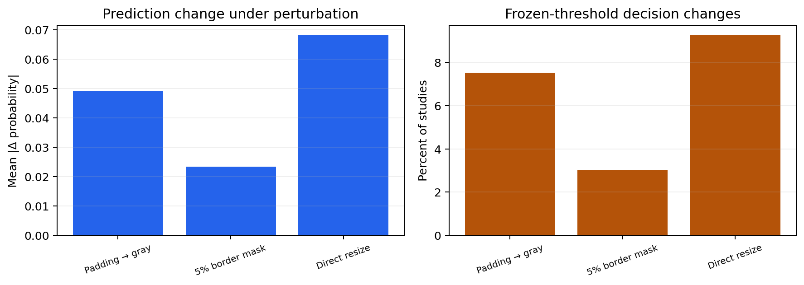

# Shortcut and geometry diagnostic

This diagnostic uses explicit internal-train/internal-validation manifests;
the official MURA `valid` split was rejected and not read. It is not a new
model-performance evaluation and does not show individual radiographs or IDs.

## What was tested

- A geometry-only, patient-grouped cross-validation warning check using view
  count, aspect ratio, and square-padding summaries.
- Controlled changes to padding pixels, an outer-border stress test, and a
  direct-resize stress test on the fixed development model.

The geometry-only warning model produced AUROC
0.697 and AUPRC
0.556. This shows that image
geometry carries label-associated information in this development population;
it **does not** prove that the ResNet uses a shortcut or that it reasons from
anatomy.

| Perturbation | Mean \|Δ probability\| | Decision flips at frozen threshold |
|---|---:|---:|
| padding_midgray | 0.049 | 52 (7.53%) |
| outer_border_black_5pct | 0.023 | 21 (3.04%) |
| direct_resize | 0.068 | 64 (9.26%) |

The padding intervention is the most isolated frame check. Border masking and
direct resize are stress tests because they can alter image content or geometry.
These results justify preserving aspect-ratio-aware preprocessing and a future
manual/Grad-CAM diagnostic review; they are not lesion-localization evidence.
